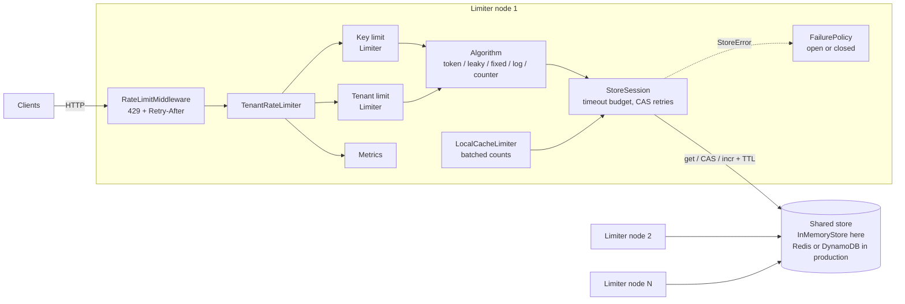
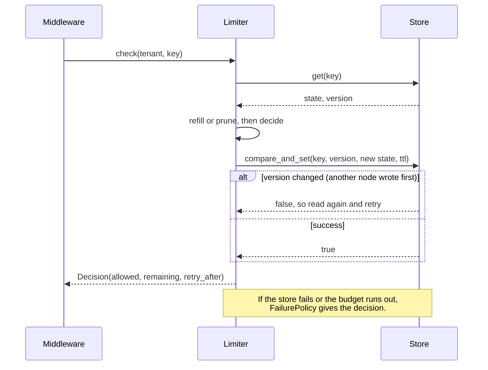

# distributed-rate-limiter

A multi-tenant rate limiter library and WSGI service in pure Python 3.12 (standard library only).

It has five algorithms. They can keep state in a shared store, so many limiter nodes enforce one global limit. The store is an in-memory model of Redis or DynamoDB: it has atomic compare-and-set, atomic increment, and TTLs. A node can also cache counts locally and sync in batches. That cuts store calls by about the batch size, and the over-admit error has a proven bound. When the store is slow or down, a timeout budget and a fail-open or fail-closed policy decide what happens.

- **Algorithms:** token bucket, leaky bucket, fixed window, sliding window log, sliding window counter.
- **Multi-tenant:** a limit per tenant, a limit per key inside a tenant, and per-key overrides.
- **Distributed mode:** CAS loops and atomic increments on a shared store, TTL on all state, and clock-skew handling.
- **Local caching:** batched counting with an over-admit bound of `nodes * batch_size - 1` per window.
- **Failure policy:** one timeout budget per decision, then fail open or fail closed. Metrics count every outcome.
- **HTTP:** WSGI middleware that returns `429 Too Many Requests` with `Retry-After` and `RateLimit-*` headers.
- **Proof:** 84 tests, and a benchmark for throughput, accuracy under concurrency, and store calls saved.

## Which algorithm to use

| Algorithm | Bursts | Memory per key | Store calls per decision | Accuracy | Use it when |
|---|---|---|---|---|---|
| Token bucket | Allows bursts up to `burst`, then a steady rate | 2 numbers | 1 read + 1 CAS | Exact | You want a steady average rate with some burst room. This is the usual default for public APIs. |
| Leaky bucket | No output bursts. Admitted requests get a `delay` that spaces them evenly | 2 numbers | 1 read + 1 CAS | Exact | A downstream system needs a smooth flow, for example a payment gateway or an email provider. |
| Fixed window | Up to 2x the limit across a window edge | 1 counter | 1 atomic increment | Exact per window, loose at edges | You want the cheapest check, or you have quotas like "1,000 per day". |
| Sliding window log | None | One timestamp per admitted request (O(limit)) | 1 read + 1 CAS | Exact over any rolling window | Limits are small and must be strict, for example login attempts or OTP sends. |
| Sliding window counter | Small. It assumes the last window was even | 2 counters | 1 read + 1 increment (+1 on deny) | Close estimate | You want rolling-window behavior at fixed-window cost. Good for high-volume APIs. |
| Cached fixed window | Same as fixed window, plus the bounded over-admit | 1 counter + local state | About `1 / batch_size` | Over-admits at most `nodes * batch_size - 1` | Traffic is very high and a small, known overshoot is fine. |

## Architecture



One decision works like this:



## Quickstart

```bash
python3.12 -m venv .venv && . .venv/bin/activate
pip install -e '.[dev]'
pytest                       # 84 tests
python bench/benchmark.py    # tables below
python examples/demo_server.py
```

The demo server listens on `127.0.0.1:8080` only:

```bash
for i in 1 2 3 4 5 6; do
  curl -s -o /dev/null -w '%{http_code} ' -H 'X-Tenant-Id: free' -H 'X-Api-Key: k1' http://127.0.0.1:8080/
done
# 200 200 200 200 200 429
curl -s http://127.0.0.1:8080/metrics
```

### One limiter

```python
from distlimit import Limiter, TokenBucket

limiter = Limiter(TokenBucket(rate=10, per=1.0, burst=20))
d = limiter.acquire("user-42")
if not d.allowed:
    print(f"retry in {d.retry_after:.2f}s")
```

### Many nodes, one shared limit

```python
from distlimit import FailMode, FailurePolicy, InMemoryStore, Limiter, LocalCacheLimiter, SlidingWindowLog

store = InMemoryStore()  # swap in a Redis or DynamoDB adapter that implements Store
policy = FailurePolicy(mode=FailMode.CLOSED, timeout=0.02)
node_a = Limiter(SlidingWindowLog(limit=5, window=60), store, policy=policy, use_store_time=True)
node_b = Limiter(SlidingWindowLog(limit=5, window=60), store, policy=policy, use_store_time=True)

# High-volume path: sync to the store once per 50 requests.
cached = LocalCacheLimiter(limit=10_000, window=1.0, store=store, batch_size=50)
```

### Tenants and HTTP

```python
from distlimit import (FixedWindow, InMemoryStore, RateLimitMiddleware, TenantPolicy,
                       TenantRateLimiter, TokenBucket)

limiter = TenantRateLimiter(
    InMemoryStore(),
    default=TenantPolicy(tenant_limit=TokenBucket(rate=100, burst=200), key_limit=FixedWindow(10, 1)),
)
limiter.set_tenant("pro", TenantPolicy(
    tenant_limit=TokenBucket(rate=1_000, burst=2_000),
    key_limit=FixedWindow(100, 1),
    key_overrides={"nightly-export": TokenBucket(rate=500, burst=5_000)},
))
app = RateLimitMiddleware(your_wsgi_app, limiter)  # reads X-Tenant-Id and X-Api-Key
```

A denied request gets:

```
HTTP/1.1 429 Too Many Requests
Retry-After: 4
RateLimit-Limit: 10
RateLimit-Remaining: 0
Content-Type: application/json

{"error": "rate_limited", "reason": "limited", "retry_after": 4}
```

`Retry-After` is rounded up to whole seconds, so a client that obeys it never retries too early.

## Benchmark results

Real output of `python bench/benchmark.py` on an Apple Silicon laptop (Python 3.12.11, macOS, arm64). The store is in memory, so these numbers show the library's own cost. With Redis or DynamoDB, the network round trip (about 0.2 to 5 ms) is the main cost, and "store calls per decision" matters most.

**Throughput, 1 thread, 1,000 keys, limit 100 per key**

| algorithm | decisions/sec | store calls/decision | allowed |
|---|---|---|---|
| token_bucket | 404,880 | 2.00 | 100% |
| leaky_bucket | 409,658 | 2.00 | 100% |
| fixed_window | 655,775 | 1.00 | 100% |
| sliding_window_log | 283,783 | 2.00 | 100% |
| sliding_window_counter | 485,737 | 2.00 | 100% |
| cached_fixed_window (batch 10) | 870,898 | 0.10 | 100% |

**Throughput, 8 threads (one process, so the GIL applies)**

| algorithm | decisions/sec | store calls/decision | allowed |
|---|---|---|---|
| token_bucket | 172,992 | 1.99 | 99% |
| leaky_bucket | 199,792 | 1.99 | 99% |
| fixed_window | 263,976 | 1.00 | 99% |
| sliding_window_log | 101,119 | 1.99 | 99% |
| sliding_window_counter | 225,711 | 2.01 | 99% |
| cached_fixed_window (batch 10) | 849,346 | 0.10 | 99% |

**Accuracy: 4 nodes x 4 threads x 500 attempts on one key, frozen clock, limit 1,000**

The clock is frozen, so the exact answer is 1,000. The benchmark makes threads switch every microsecond to force races between read and write.

| algorithm | admitted | exact limit | over-admit | documented bound | store calls | CAS retries | calls saved vs fixed_window |
|---|---|---|---|---|---|---|---|
| token_bucket | 1000 | 1000 | 0 | 0 | 11020 | 1010 | - |
| leaky_bucket | 1000 | 1000 | 0 | 0 | 11202 | 1101 | - |
| fixed_window | 1000 | 1000 | 0 | 0 | 8000 | 0 | - |
| sliding_window_log | 1000 | 1000 | 0 | 0 | 24834 | 7917 | - |
| sliding_window_counter | 1000 | 1000 | 0 | 0 | 23000 | 0 | - |
| cached_fixed_window (batch 1) | 1003 | 1000 | 3 | <= 3 | 1003 | 0 | 87.5% |
| cached_fixed_window (batch 10) | 1030 | 1000 | 30 | <= 39 | 103 | 0 | 98.7% |
| cached_fixed_window (batch 50) | 1150 | 1000 | 150 | <= 199 | 23 | 0 | 99.7% |

What the table shows:

- All five store-backed algorithms admit exactly the limit under heavy contention. Token bucket, leaky bucket, and the log pay for it with CAS retries on a hot key. The log retries the most. Its compute step copies the whole log, so the gap between read and write is wider.
- Fixed window and sliding window counter use atomic increments, so they never retry.
- The cached limiter stays inside its bound every time. At batch 1 it still saves calls, because a node that knows the limit is reached denies locally with no store call. At batch 50 it makes 23 store calls instead of 8,000.

**Failure policy, timeout budget 50 ms**

| store | policy | allowed | avg decision ms | store errors |
|---|---|---|---|---|
| healthy | open | 100% | 0.00 | 0 |
| healthy | closed | 100% | 0.00 | 0 |
| slow (200 ms) | open | 100% | 53.52 | 40 |
| slow (200 ms) | closed | 0% | 53.13 | 40 |
| down | open | 100% | 0.02 | 40 |
| down | closed | 0% | 0.02 | 40 |

A slow store costs the budget (50 ms) and not the full 200 ms. A store that is down fails fast.

## How distributed mode works

**Shared state.** Each algorithm keeps its state in the `Store` as an immutable value. Token bucket, leaky bucket, and the log do read, compute, then `compare_and_set` on the version they read. If another node wrote first, the CAS fails and the loop reads again. Fixed window and sliding window counter use `incr`, which is one atomic step. In Redis, the CAS loop is a Lua script or `WATCH`/`MULTI`, and `incr` is `INCRBY` plus `EXPIRE ... NX`. In DynamoDB, CAS is a conditional `PutItem` on a version attribute, and `incr` is `UpdateItem ... ADD` with a TTL attribute.

**TTL.** Every key has a TTL, so idle keys clean themselves up. The TTL is the time until the state is the same as "no state", for example a full bucket, an empty queue, or a window that ended. So an expired key and a fresh key give the same answer. Versions never repeat, so a key that expires and comes back cannot accept a stale CAS.

**Local caching and its bound.** `LocalCacheLimiter` admits against `last known global count + local unsynced count`. It pushes the unsynced count with one `incr` when it reaches `batch_size`, or when `sync_interval` has passed. The bound per key and window is:

```
admitted <= limit + nodes * batch_size - 1
```

Before the store count reaches the limit, each sync adds at most `batch_size`. So the sync that crosses the limit leaves at most `limit - 1 + batch_size`. After that, each other node can add at most one more batch that it built on a stale count. Its next sync shows it the limit, and it stops. The concurrency test and the benchmark check this bound, and batch 1 hits it exactly (1003 with 4 nodes).

**Clock skew.** Each node has its own clock, and clocks drift. Two rules handle this:

1. Elapsed time is never negative, and a stored timestamp never moves backward. A slow node sees no refill until its clock catches up. It reports that wait in `retry_after` and `delay`. It cannot rewind the stored time and so give a fast node a second refill.
2. A fast node can still refill early. The overshoot is at most `rate * skew` (tested). To remove it, set `use_store_time=True`. Then every node uses the store's clock (like Redis `TIME`) for one extra store call per decision.

Window algorithms key the window by `floor(now / window)`. Their counter TTL is two windows, so a node near a window edge still finds the right counters.

**Failure policy.** `StoreSession` gives each decision one timeout budget. All store calls and CAS retries share it. Each call gets only the time that is left, so a slow store cannot take more than the budget. When the budget runs out, or the store raises an error, or CAS retries go past `max_cas_retries`, `FailurePolicy` decides:

- **Fail open** (default): allow the request. Use it when the limiter protects capacity, and an outage of the limiter must not become an outage of the product.
- **Fail closed**: deny with `Retry-After`. Use it when the limit protects money or security, for example SMS sends, password guesses, or paid third-party calls.

`Metrics` counts allowed and denied, the reason (`ok`, `limited`, `fail_open`, `fail_closed`), store calls, CAS retries, and errors by type. It also counts allowed and denied per tenant.

## Trade-offs

- **CAS or atomic increment.** CAS works for any state but retries on hot keys (see the log row). Increments never retry, but they only fit counter algorithms. In production, a Redis Lua script removes the retries, because the script runs on the server in one step.
- **Exact or cheap.** The sliding window log is exact, but memory grows with the limit. The sliding window counter uses two numbers and is a close estimate. Pick the log only for small, strict limits.
- **Store calls or accuracy.** Local caching trades a known overshoot for far fewer store calls. Batch size is the knob. A good start is `batch_size = limit / (nodes * 20)`. That keeps the worst-case overshoot near 5%.
- **Fail open or fail closed.** Fail open keeps the product up, but during an outage there is no limit. Fail open also voids the caching bound, because unsynced counts can grow. Fail closed keeps the limit, but the store becomes a hard dependency.
- **Key first or tenant first.** `TenantRateLimiter` checks the key limit first, then the tenant limit. If the tenant limit denies, the key has already spent its token. That keeps each limit to one atomic step and does not need a two-key transaction. The cost is a small under-admit for that key.
- **Local time or store time.** Store time removes skew error for one extra call. Local time is free, and its error is `rate * skew`, which is small when NTP keeps skew in milliseconds.
- **What this project does not include.** There is no circuit breaker, so during an outage each request still waits for its budget. There is no real Redis or DynamoDB adapter, and no multi-region sync. These are the next steps listed below.

## System design interview notes

**Requirements to ask about first.** What is limited: user, API key, IP, or tenant? Is the limit hard (billing, abuse) or soft (fairness)? What overshoot is acceptable? What is the latency budget for the check? Is it one region or many? Is the limit per endpoint or global?

**Back-of-envelope.** At 100k requests per second, a store-backed check is 100k to 200k store operations per second. That is one large Redis cluster. With batch 50, it is about 2k operations per second. Memory for token buckets is about 100 bytes per key, so 10M keys is about 1 GB. A sliding log at limit 1,000 is at least 8 KB per key (1,000 timestamps), so 10M keys is at least 80 GB. This is why the log is only for small limits.

**Where the limiter goes.** At the API gateway or edge, for coarse per-IP and per-tenant limits. In a sidecar or middleware, for per-route limits. Inside the service, for business limits like "3 password resets per hour". This project is the middleware form.

**Data model.**
- Token bucket: `HSET bucket:{tenant}:{key} tokens last_ts`, updated in a Lua script with `PEXPIRE`.
- Fixed window: `INCRBY rl:{key}:{window_idx}` plus `EXPIRE NX`.
- Sliding log: a sorted set: `ZREMRANGEBYSCORE`, `ZCARD`, `ZADD`, all in one script.
- DynamoDB: one item per key, a `version` attribute for conditional writes, and a `ttl` attribute.

**Hot keys.** One tenant can make one key very hot. The fixes are local caching with batched sync (this project), splitting the counter into N sub-counters and summing them, or giving each node a fixed share of the limit (`limit / nodes`). A fixed share needs no coordination, but it under-admits when traffic is uneven.

**Many regions.** A global, exact limit needs a cross-region round trip on every request, which is too slow. Common answers: give each region its own limit (a share of the global limit), or keep local counts and sync between regions in the background, and accept a bounded overshoot. That second answer is the same idea as `LocalCacheLimiter`, one level up.

**Client contract.** Return `429` with `Retry-After`, plus `RateLimit-Limit` and `RateLimit-Remaining`. Clients should back off with jitter, so they do not all retry at the same moment.

**Follow-up questions to expect.**
- *"How do you prove there is no over-admit?"* All writes are a CAS on a version, or a single atomic increment. The concurrency tests run 16 threads on 4 nodes with forced thread switches, and they check that exactly the limit is admitted.
- *"What if the store goes down?"* A timeout budget, then fail open or fail closed, chosen per limit. In production, add a circuit breaker and a local fallback limit (for example `limit / nodes` in memory).
- *"What about clock skew?"* Never let time go backward, bound the error at `rate * skew`, or use the store's clock.
- *"Why not one counter per second?"* That is a fixed window. It allows 2x bursts at the edges. The sliding window counter fixes most of that for one more read.

## Project layout

```
distlimit/
  algorithms.py   the five algorithms and the CAS loop
  cache.py        LocalCacheLimiter (batched counts, over-admit bound)
  clock.py        SystemClock, ManualClock, SkewedClock
  decision.py     Decision and reason codes
  limiter.py      Limiter, FailurePolicy
  metrics.py      thread-safe counters, total and per tenant
  session.py      StoreSession (timeout budget, CAS retry cap)
  store.py        Store interface, InMemoryStore, FaultyStore
  tenants.py      TenantRateLimiter, TenantPolicy
  wsgi.py         RateLimitMiddleware
examples/demo_server.py
bench/benchmark.py
tests/
```

## Next steps

- A Redis adapter with Lua scripts, and a DynamoDB adapter with conditional writes.
- A circuit breaker in `StoreSession`, so an outage costs one timeout and not one per request.
- Background sync for `LocalCacheLimiter`, so no request waits on a sync call.

## License

MIT. See [LICENSE](LICENSE).
